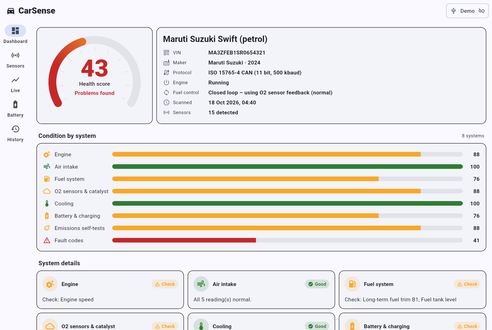
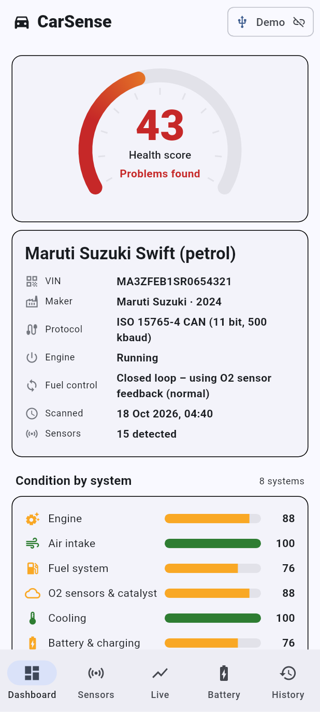
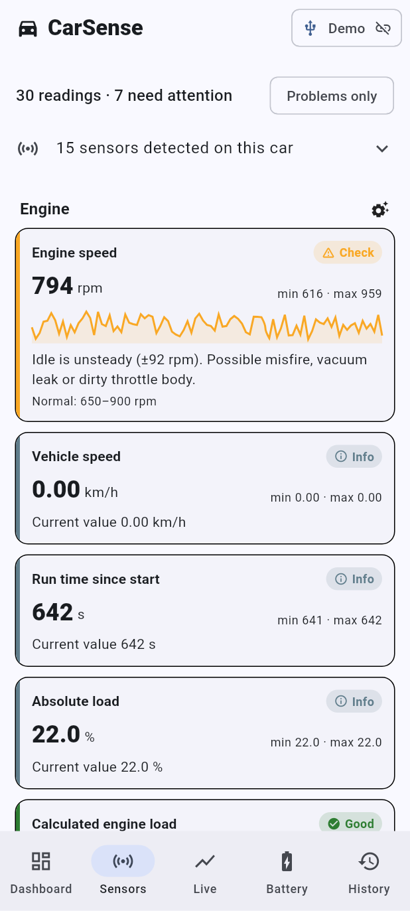
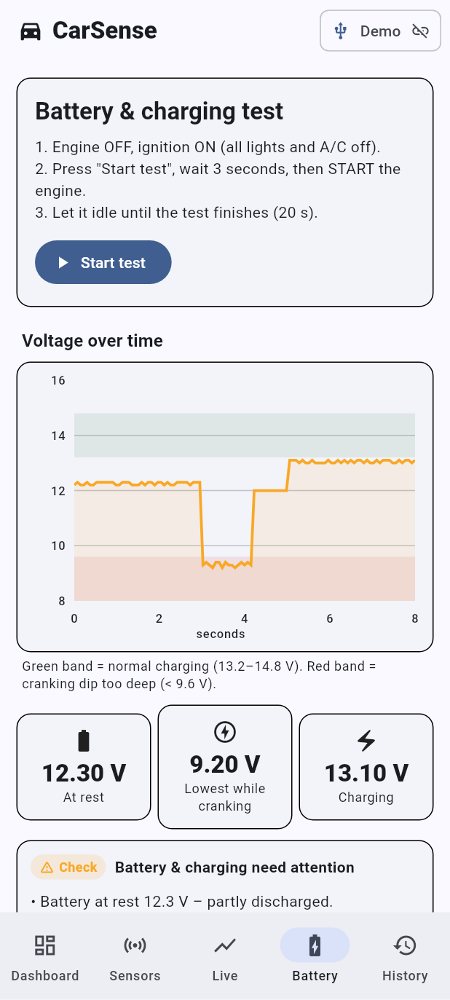
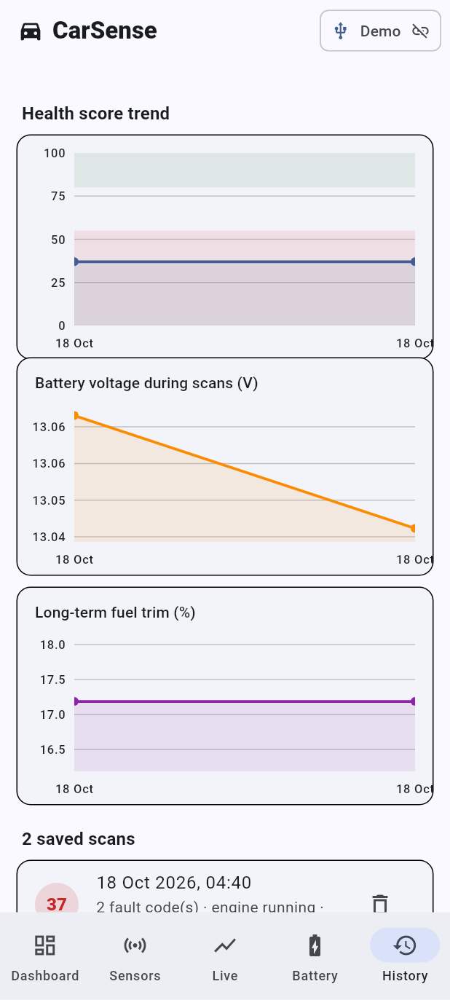
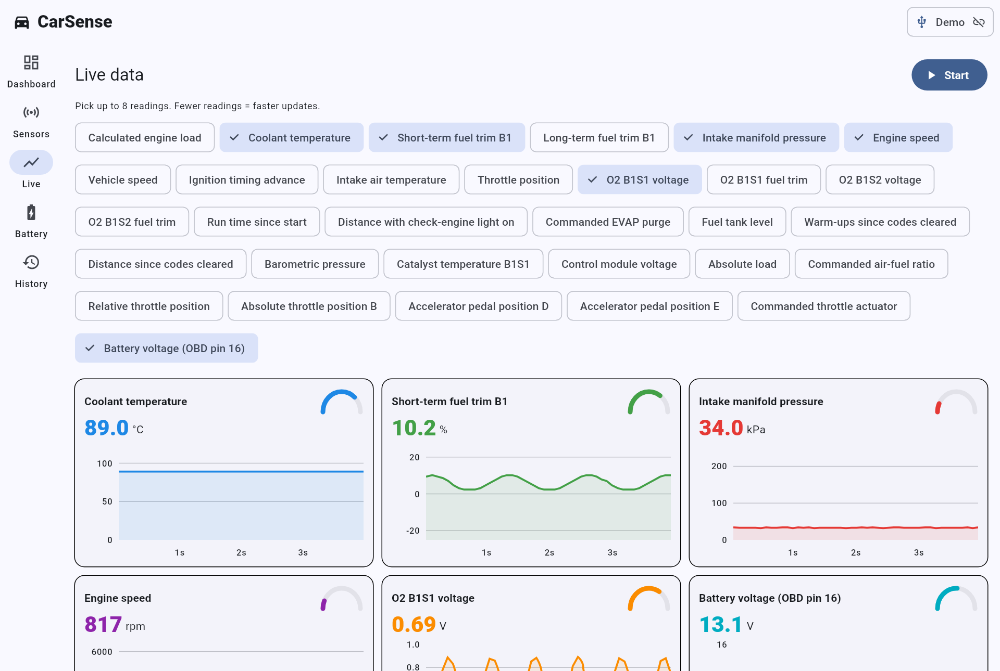

# CarSense OBD

**Read-only car health checker for Windows and Android.** Plug a USB OBD-II adapter into your car and
CarSense will detect which sensors the car has, test them, read fault codes, check the battery and
alternator, and show the results as a dashboard with charts.

It is built and tuned for the **Tata Nexon (petrol)** and **Maruti Suzuki Swift (petrol)**, but it works on any
petrol car with an OBD-II port.

> 🔒 **Check-only.** CarSense never writes to the car. It cannot clear fault codes, reset the check-engine light,
> run actuator tests or change settings. Every command goes through a built-in allowlist
> ([`read_only_guard.dart`](lib/elm327/read_only_guard.dart)), and tests confirm that anything else is blocked.

| Dashboard (Windows) | Phone |
|---|---|
|  |  |

| Sensors | Battery test | History |
|---|---|---|
|  |  |  |



*(The screenshots come from the built-in "Swift with faults" demo car.)*

---

## What it checks

| Area | How |
|---|---|
| **Sensor detection** | Asks the engine computer which readings it supports, then lists the physical sensors fitted (ECT, IAT, MAP, TPS, pedal, O2 sensors, catalyst temperature, etc.). For the Nexon and Swift it also shows a reference list, including sensors such as knock and cam sensors that only report through fault codes. |
| **Sensor health** | Samples every reading for about 15 s and checks it against normal ranges for that car. It looks for idle stability, warm-up and thermostat behaviour, MAP vacuum, fuel trims, upstream O2 sensor switching, downstream O2 sensor and catalyst efficiency, catalyst temperature, and wiring faults (readings stuck at the limit). |
| **Fault codes** | Stored, pending and permanent DTCs, each with a plain-English meaning and a severity. |
| **Check-engine light & self-tests** | MIL status and every readiness monitor (catalyst, EVAP, O2 sensor, O2 heater, misfire, fuel system, …). |
| **Battery & charging** | Resting voltage, cranking dip and alternator charging voltage, recorded as a chart while you start the engine. |
| **Health score** | 0–100 overall, plus a score per system (Engine, Air intake, Fuel, O2 & catalyst, Cooling, Battery, Emissions, Fault codes). |
| **Live data** | Up to 8 live charts with gauges (RPM, coolant, O2 voltage, trims, MAP, battery…). |
| **History & trends** | Every scan is saved on the device. Charts show the score, battery voltage and fuel trims over time. |
| **PDF report** | Export or share a full report. |

## Hardware you need

| Item | Notes |
|---|---|
| USB OBD-II adapter | **Recommended:** [OBDLink EX](https://www.obdlink.com/products/obdlink-ex/) or [Vgate vLinker FS USB](https://www.ubuy.co.in/product/JO9D7FUD2-fs-usb-obd2-adapter-diagnostic-tool-for-forscan-hs-ms-can-car-auto-switch-ecu-programming-modification-hacker-proof-unlock-advanced-and). **Budget:** a generic *ELM327 USB v1.5* cable ([Amazon.in search](https://www.amazon.in/s?k=ELM327+USB+OBD2+v1.5)). Avoid "v2.1" clones. |
| Android only | A **USB-OTG adapter** (USB-A female to USB-C) ([Amazon.in search](https://www.amazon.in/s?k=usb+otg+adapter+type+c+to+usb+a)). |
| Windows only | Install the cable's driver if no COM port appears (CH340 or FTDI, usually linked on the seller's page). |

The OBD-II port is under the dashboard on the driver's side, near your knees, on both the Nexon and the Swift.

## Install

Every push to `main` builds the apps automatically. Download them from the
**Actions** tab: open the latest *Build* run and scroll to **Artifacts**.

* **Android:** `CarSense-android-apk` → `CarSense-android.apk`. Copy it to the phone and open it (allow
  "install unknown apps").
* **Windows:** `CarSense-windows` → unzip anywhere → run `carsense_obd.exe`.

Pushing a tag such as `v1.0.0` also creates a GitHub Release with both files attached.

## How to use

1. Park the car and plug the adapter into the OBD port. On a phone, connect it through the OTG adapter.
2. Turn the ignition **ON**. For the most complete check, start the engine and let it idle until warm.
3. Open CarSense and pick your adapter. The app identifies the car from its VIN (Tata → Nexon profile,
   Maruti → Swift profile). You can change the profile manually.
4. Tap **Run full health check** (about 30 s).
5. Optional: open **Battery**, press *Start test*, and start the engine within 3 seconds.

No car nearby? Choose one of the **demo cars** on the connect screen to try every feature.

## Supported protocols

The app auto-detects all OBD-II protocols the adapter supports: ISO 15765-4 CAN (11/29-bit, 250/500 kbaud),
ISO 14230-4 KWP2000, ISO 9141-2 and SAE J1850. The Nexon and post-2018 Swift use **CAN 11-bit 500 kbaud**. Older
Swifts may use KWP2000.

## Limitations

* Only **generic OBD-II** data is read. Sensors in the ABS, airbag and body-control modules use
  Tata/Maruti-specific protocols and are not covered (a possible future, still read-only, extension).
* A cheap clone adapter can be slow or drop out. If a scan fails, try again or use a better adapter.
* The results are a guide. They do not replace an inspection by a mechanic.

## Development

```bash
flutter pub get
flutter analyze
flutter test                                   # unit + full demo-car UI flow
SCREENSHOT_DIR=/tmp/shots flutter test test/ui_smoke_test.dart   # also saves screenshots
flutter run -d windows                         # or an Android device
```

```
lib/
 ├─ transport/     USB (Android OTG), COM port (Windows), simulated demo car
 ├─ elm327/        ELM327 protocol, response parser (ISO-TP / KWP), read-only guard
 ├─ obd/           PID decoders, DTCs + descriptions, readiness monitors, VIN, scan service
 ├─ vehicles/      Nexon / Swift / generic profiles and normal ranges
 ├─ diagnostics/   Health engine (rules, scores, battery test), report models
 ├─ data/          On-device scan history
 ├─ report/        PDF export
 └─ ui/            Dashboard, Sensors, Live, Battery, History screens + charts
```
