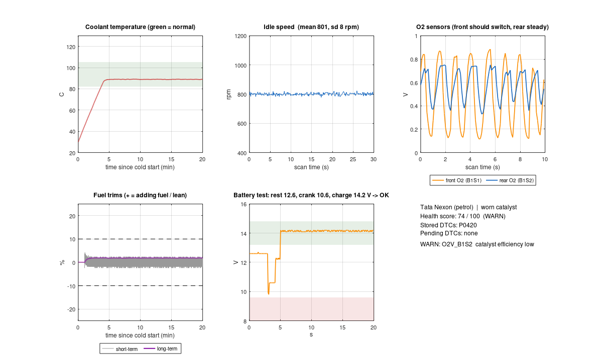

# Car simulation (MATLAB / GNU Octave)

A physics-based simulation of the **Tata Nexon** and **Maruti Swift** petrol engines and an
independent MATLAB implementation of the CarSense diagnosis. It is used to:

1. **Test the diagnosis logic** against 9 known fault scenarios on both cars.
2. **Cross-check the app.** Each scenario is exported as the exact ELM327 adapter replies the app would
   receive. The app "connects" to these replays, and `test/matlab_replay_test.dart` checks that its
   verdicts match MATLAB's for every sensor, fault code, the score and the battery test.
3. **Demo the app.** The replays ship with the app under *Connect → MATLAB simulations*.

Runs in MATLAB R2019b+ or GNU Octave 7+ (no toolboxes).

## What is simulated

20 minutes from a cold start at 30 °C to warm idle, at 0.1 s steps:

| Model | Details |
|---|---|
| Cooling | Heat input vs. radiator with a thermostat that opens between 85 and 95 °C and a fan |
| Idle speed | Fast idle when cold, random misfire dips |
| Fuel control | Narrow-band O2 sensor, 0.3 s transport delay, short-term trim (switching integrator), long-term trim learning |
| Catalyst | Oxygen storage, which filters what the rear O2 sensor sees |
| Electrical | Battery open-circuit voltage + internal resistance, starter inrush and cranking current, alternator |
| Engine computer | Sets DTCs, the check-engine light and readiness monitors from what it measures |

Scenarios: `healthy`, `vacuum_leak`, `worn_catalyst`, `dead_o2_sensor`, `stuck_thermostat`,
`overheating`, `misfire`, `weak_battery`, `alternator_fault`.

## Run

```matlab
cd simulation
addpath('tests'); run_tests      % 9 tests: codec, framing, physics, verdicts, battery …
run_simulation                   % all scenarios -> ../assets/simulations/*.json, output/plots/*.png
```

GNU Octave from a terminal:

```bash
cd simulation
octave-cli --eval "addpath('tests'); run_tests"
xvfb-run -a octave --no-gui --eval "run_simulation"   # plots need a (virtual) display
```

Then check the app against the new replays: `flutter test test/matlab_replay_test.dart`.

## Results (seed 1)

See [`output/summary.md`](output/summary.md) and the plots in [`output/plots`](output/plots).



## Files

| File | Purpose |
|---|---|
| `carsim_profile.m` | Car parameters (idle speed, MAP, ranges, supported PIDs, VIN) |
| `carsim_scenarios.m` | Fault scenario parameters |
| `carsim_simulate.m` | The car + engine computer simulation |
| `obd_encode.m` / `obd_decode.m` | SAE J1979 mode 01 value ↔ bytes |
| `dtc_codec.m` | Trouble code text ↔ 2 bytes |
| `elm_frame.m` / `elm_parse.m` | ELM327 CAN text format incl. ISO-TP multi-frame |
| `carsim_replies.m` / `carsim_read.m` | Simulation → adapter replies → decoded readings |
| `carsim_diagnose.m` / `carsim_battery_eval.m` | MATLAB version of the app's health rules |
| `carsim_export_replay.m` | Writes replay JSON for the app |
| `carsim_plot.m` | Six-panel overview plot |
| `run_simulation.m` | Runs everything |
| `tests/run_tests.m` | Test suite |
